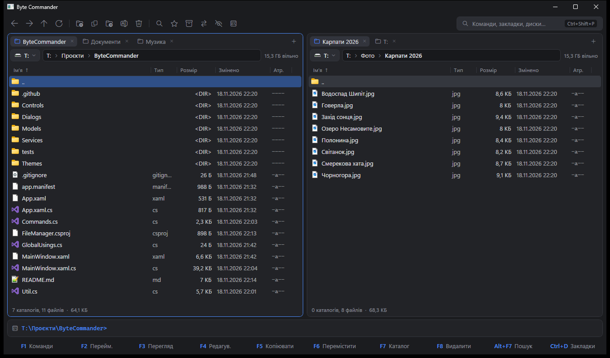
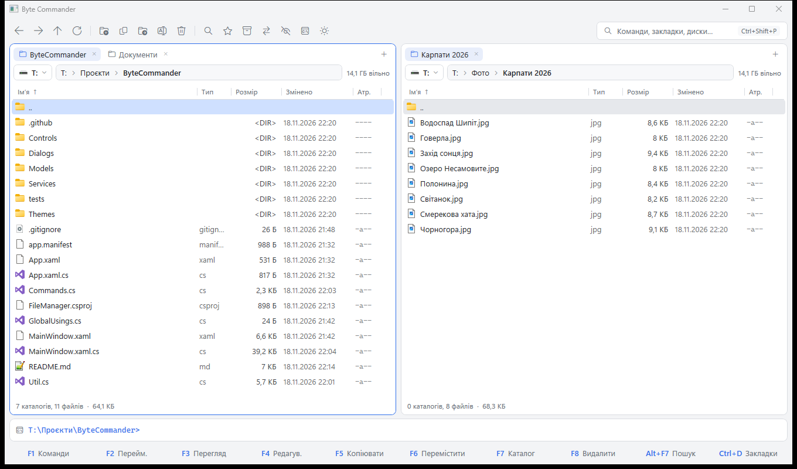

# Byte Commander

[](https://github.com/ekucher/ByteCommander/actions/workflows/ci.yml)

[](https://github.com/ekucher/ByteCommander/releases/latest)

[](LICENSE)

Двопанельний файловий менеджер для Windows у дусі **Total Commander** і **Far Manager**, але з сучасним інтерфейсом:
вкладки, хлібні крихти, палітра команд, темна тема, нативне контекстне меню Провідника. Клавіатура лишається головним
інструментом: F-клавіші, позначення через Insert/Space, швидкий пошук.



<details><summary>Світла тема</summary>



</details>

## Можливості

**Панелі**
- Дві панелі з вкладками, історією назад/вперед і клікабельним шляхом (хлібні крихти, клік — введення шляху вручну)
- Системні іконки, природне сортування як у Провіднику, автооновлення при змінах на диску
- Позначення в стилі TC/Far: Insert, Space, Shift+стрілки, Ctrl/Shift+клік, маски (Num + / Num − / Num *)
- Швидкий пошук — просто друкуйте ім'я; фільтр списку — Ctrl+F
- Розмір каталогів на вимогу (Space / F3 на каталозі)

**Файлові операції**
- Копіювання й переміщення у фоні: прогрес, швидкість, час до кінця, прогрес на панелі задач
- Конфлікти імен: замінити / пропустити / перейменувати, з варіантом «для всіх»
- Безпечний перезапис: новий вміст пишеться в тимчасовий файл і атомарно замінює старий, тож збій чи скасування не знищують наявний файл
- Видалення в кошик або назавжди; посилання та точки з'єднання видаляються як посилання, без заходу всередину
- ZIP: пакування й розпакування із захистом від zip-slip і правильними кириличними іменами з архівів Провідника

**Інтеграція з Windows**
- Нативне контекстне меню Провідника (правий клік, Shift+F10, клавіша Menu)
- Drag & drop між панелями та з/у Провідник
- Буфер обміну файлів (Ctrl+C / X / V), сумісний із Провідником
- Властивості файлу, термінал у поточному каталозі, «показати в Провіднику»

**Інструменти**
- Переглядач (F3) для файлів **будь-якого розміру**: великі файли читаються з диска частинами, рядки індексуються у фоні, пошук іде потоково. Текст (у великих файлах — з номерами рядків), hex, зображення з гортанням стрілками; кодування UTF-8, 1251, 866, KOI8-U, UTF-16
- Вбудований редактор (F4) з пошуком
- Пошук файлів (Alt+F7) за масками і вмістом, зокрема у файлах у Windows-1251 / CP866
- Палітра команд (F1 / Ctrl+Shift+P) з нечітким пошуком по всіх командах, закладках і дисках
- Закладки, командний рядок з історією та `cd`
- Темна і світла тема або «як у системі»: перемикаються на льоту, без перезапуску (кнопка ☀ на панелі інструментів або палітра команд)
- `ByteCommander.exe --view <файл>` відкриває лише переглядач, тож його можна вибрати в «Відкрити за допомогою»

Вкладки, сортування, закладки і розмір вікна зберігаються між запусками в `%APPDATA%\ByteCommander\settings.json`.

## Встановлення

Завантажте архів зі сторінки [Releases](https://github.com/ekucher/ByteCommander/releases/latest) (Windows 10/11 x64):

| Файл | Для кого |
|---|---|
| `ByteCommander-<версія>-win-x64-selfcontained.zip` | **Рекомендовано.** Розпакуйте й запустіть `ByteCommander.exe`, нічого встановлювати не треба |
| `ByteCommander-<версія>-win-x64.zip` | Маленький (менше 1 МБ), потрібен [.NET 10 Desktop Runtime](https://dotnet.microsoft.com/download/dotnet/10.0) |

> **Попередження SmartScreen.** `.exe` не підписаний цифровим сертифікатом, тому при першому запуску Windows може
> показати «Windows захистив ваш ПК». Натисніть **Докладніше → Виконати однаково**. Цілісність завантаження можна
> перевірити за контрольними сумами з `SHA256SUMS.txt` у релізі:
> `Get-FileHash .\ByteCommander-*.zip -Algorithm SHA256`

### Збирання з коду

Потрібен .NET 10 SDK.

```powershell
git clone https://github.com/ekucher/ByteCommander.git
cd ByteCommander
dotnet build -c Release
.\bin\Release\net10.0-windows\ByteCommander.exe [лівий_каталог] [правий_каталог]
```

### Новий реліз

```powershell
git tag v0.2.0
git push origin v0.2.0
```

Workflow `Release` прожене тести, збере обидва варіанти й опублікує реліз з архівами та контрольними сумами.
Теги з дефісом (`v0.2.0-beta`) публікуються як pre-release.

## Тести

```powershell
dotnet test tests\ByteCommander.Tests
```

56 тестів на xUnit: перезапис і конфлікти, переміщення між томами, посилання, видалення, ZIP (CP866, zip-slip,
скасування), пошук за вмістом у різних кодуваннях, віртуальний переглядач (розбиття на рядки, UTF-16, довгі рядки,
пошук, hex), однаковий набір кольорів у темах, сумісність налаштувань. Тести міжтомних операцій тимчасово
підключають робочий каталог як окремий диск через `subst` і знімають його після прогону.
CI на GitHub Actions (`windows-latest`) збирає застосунок, проганяє тести й викладає збірку як артефакт.

## Структура

| Шлях | Що там |
|---|---|
| `MainWindow.xaml(.cs)` | Головне вікно, реєстр команд і гарячих клавіш, діалоги операцій |
| `Commands.cs` | `Hotkey` і `AppCommand` — єдине джерело клавіш для обробника, палітри, F-панелі й меню |
| `Controls/FilePanel.xaml(.cs)` | Файлова панель: вкладки, навігація, позначення, швидкий пошук, drag & drop |
| `Services/FileOperation.cs` | Копіювання, переміщення, видалення, ZIP з прогресом і конфліктами |
| `Services/ShellContextMenu.cs` | Нативне контекстне меню Провідника (COM `IContextMenu`) |
| `Services/NativeMethods.cs`, `ShellIcons.cs` | WinAPI: іконки, кошик, властивості, темний заголовок |
| `Dialogs/` | Вікно переглядача/редактора, пошук, палітра команд, прогрес, прості діалоги |
| `Viewer/` | Віртуальний перегляд великих файлів: джерела рядків (текст з фоновою індексацією, hex) і елемент, що малює лише видиме |
| `Themes/Colors.Dark.xaml`, `Colors.Light.xaml` | Палітри тем (однаковий набір ключів) |
| `Themes/Controls.xaml` | Стилі всіх контролів; кольори через `DynamicResource` |
| `Services/ThemeManager.cs` | Перемикання теми на льоту, режим «як у системі» |
| `tests/ByteCommander.Tests` | Тести xUnit |
## Гарячі клавіші

Усі команди з клавішами також є в палітрі команд (**F1** / **Ctrl+Shift+P**). Палітра будується з того самого реєстру команд, що й обробник клавіш, тож вона завжди актуальна.

### Навігація

| Клавіша | Дія |
|---|---|
| Tab | Інша панель |
| Enter | Відкрити файл / увійти в каталог |
| Backspace, Alt+↑, Ctrl+PgUp | Вгору |
| Ctrl+PgDn | Увійти в каталог під курсором |
| Alt+← / Alt+→ | Назад / вперед |
| Ctrl+\\ | Корінь диска |
| Alt+F1 / Alt+F2 | Диск лівої / правої панелі |
| Ctrl+L | Ввести шлях |
| Ctrl+= | Той самий каталог в іншій панелі |
| Ctrl+U | Поміняти панелі місцями |
| Ctrl+D / Ctrl+Shift+D | Закладки / додати або прибрати закладку |
| Ctrl+T / Ctrl+W | Нова / закрити вкладку |
| Ctrl+Tab / Ctrl+Shift+Tab | Наступна / попередня вкладка |
| Середня кнопка миші | На каталозі — відкрити у фоновій вкладці; на вкладці — закрити |
| Друк літер | Швидкий пошук за іменем (пробіл і «-» теж працюють) |
| Ctrl+F | Фільтр у панелі |

### Позначення

| Клавіша | Дія |
|---|---|
| Insert | Позначити й перейти далі |
| Space | Позначити (для каталогу — ще й порахувати розмір) |
| Shift+↑ / Shift+↓ | Позначати, рухаючись |
| Ctrl+клік / Shift+клік | Позначити один / діапазон |
| Ctrl+A / Ctrl+Shift+A | Виділити все / зняти виділення |
| Num + / Num − / Num * | Виділити за маскою / зняти за маскою / інвертувати |

### Файли

| Клавіша | Дія |
|---|---|
| F3 | Перегляд (для каталогу — розмір) |
| F4 / Shift+F4 | Редагувати / новий файл |
| F5 / F6 | Копіювати / перемістити |
| F2, Shift+F6 | Перейменувати |
| F7, Ctrl+Shift+N | Новий каталог |
| F8, Del | У кошик |
| Shift+F8, Shift+Del | Видалити назавжди |
| Alt+F5 / Alt+F9 | Запакувати в ZIP / розпакувати |
| Alt+F7 | Пошук файлів |
| Alt+Enter | Властивості |
| Alt+Shift+Enter | Порахувати розмір усіх каталогів |
| Shift+F10, Menu | Контекстне меню Провідника |
| Ctrl+C / Ctrl+X / Ctrl+V | Буфер обміну файлів (сумісний із Провідником) |
| Ctrl+Shift+C | Копіювати повний шлях |
| Ctrl+F3 / F4 / F5 / F6 | Сортувати: ім’я / тип / дата / розмір |

### Інше

| Клавіша | Дія |
|---|---|
| F1, Ctrl+Shift+P, Ctrl+P | Палітра команд |
| Ctrl+E | Командний рядок |
| Ctrl+Enter | Вставити ім’я файлу в командний рядок |
| Ctrl+` | Термінал у поточному каталозі |
| Ctrl+Shift+E | Відкрити в Провіднику |
| Ctrl+R | Оновити панель |
| Ctrl+H | Показати / сховати приховані файли |
| Alt+X | Вихід |

### У переглядачі / редакторі

| Клавіша | Дія |
|---|---|
| Esc, F3 | Закрити (F3 — лише в переглядачі) |
| F4 | Hex-режим (переглядач) |
| Ctrl+F, Enter / F3 | Пошук / наступний збіг |
| Ctrl+S, F2 | Зберегти (редактор) |
| Ctrl+Home / Ctrl+End | Початок / кінець файлу |
| ← → PgUp PgDn | Попереднє / наступне зображення |

Файли до 8 МБ відкриваються у звичайному текстовому полі з виділенням і копіюванням. Більші файли та hex-режим відкриваються у віртуальному режимі: розмір не обмежений, є номери рядків і пошук, але без виділення тексту. Редактор (F4) працює з файлами до 8 МБ.

## Ліцензія

[MIT](LICENSE) © 2026 ekucher
